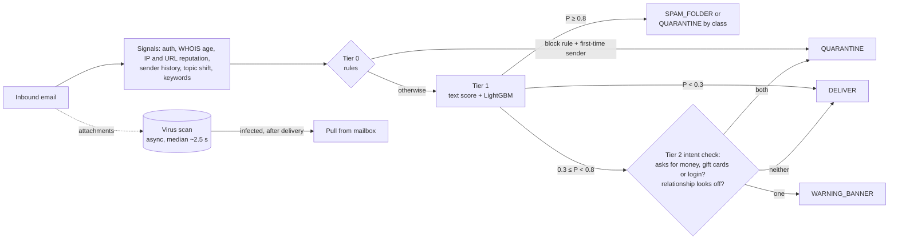

# bec-guard

A tiered spam / phishing / BEC (business email compromise) filter for a multi-tenant B2B email
platform. Cheap rules and a gradient-boosted model handle almost all mail in ~10 ms; only gray-zone
emails get a second look; a slow attachment scan runs in the background. Everything runs locally,
no API keys, on reproducible synthetic data.

**Cost: $0.008 per mailbox per month (2.8% of the $0.30 budget)** at the specified 5 inbound emails
per mailbox per day; still within budget ($0.20, 66%) in a 120 emails/day stress test.

## Key result

Held-out last 12 days (1,963 emails, 388 malicious, true labels). "Detected" means any action other
than DELIVER; models were trained on labels with 2% noise.

| Approach | PR-AUC | Precision | Recall | BEC recall | Hard-positive recall | Legit flagged |
|---|---|---|---|---|---|---|
| Rules only (Tier 0 block) | 0.585 | 100.0% | 17.0% | 59.4% | 0.0% | 0 |
| Text only (TF-IDF + LR) | 0.860 | 53.7% | 87.4% | 92.8% | 81.8% | 292 |
| Metadata only (no text features) | 0.985 | 96.5% | 93.0% | 84.1% | 36.4% | 13 |
| Full model (LightGBM, all features) | **0.993** | 100.0% | 95.9% | 97.1% | 51.5% | 0 |
| **Full cascade** (rules → model → intent check) | – | 99.2% | 95.9% | **97.1%** | **54.5%** | 3 |

- **Text alone is not enough.** It finds most attacks only by also flagging 292 legit emails (18% of
  legit mail), because legit invoices, payment chasers and IT notices use the same words.
- **Relationship + infrastructure features carry BEC.** Who is writing (first-time sender, prior
  exchanges, lookalike or freemail domain, display-name and reply-to tricks) is what separates a real
  CFO's urgent wire request from a fake one. Combining them with the text score gives the best of both.
- **Hard positives remain hard.** Attacks from hijacked real accounts that copy normal wording are
  caught about half the time; see [Limitations](#limitations).

Full report: [reports/eval_report.md](reports/eval_report.md).

## Quickstart

```bash
make setup               # Python 3.11 venv via uv (macOS: run `brew install libomp` once first)
make data train eval     # ~10k synthetic emails -> models/ -> reports/   (~30 seconds)
make demo                # Streamlit app on http://localhost:8501
```

`make test` runs the test suite. **macOS:** LightGBM needs the OpenMP runtime; without
`brew install libomp`, importing it fails with `Library not loaded: @rpath/libomp.dylib`.

## The problem and the constraints

A B2B email provider must classify every inbound email into **DELIVER**, **WARNING_BANNER**,
**SPAM_FOLDER** or **QUARANTINE**, with reason codes the customer's admin can read.

- **Budget: $0.30 per mailbox per month.** At the specified 5 inbound emails per mailbox per day
  (30 mailboxes per customer) that is 150 emails, so **$0.002 per email** for compute, reputation
  lookups and attachment scanning together. The design must also survive a heavy inbox: at 120/day
  the budget shrinks to $0.00008 per email, where a hosted LLM call on every email is out of reach.
- **Latency: the provider gives up after 5 s** and delivers anyway (fail open). Target p99 < 2 s.
- **BEC is the expensive failure.** It has no malicious link or file to detect; the signal is
  *who* is asking *what*, compared with how this sender normally behaves.
- **Multi-tenant.** Every tenant has its own executives, vendors and correspondents, so "normal"
  must be learned per tenant from point-in-time history.

## Architecture



| Tier | What it does | Share of test mail |
|---|---|---|
| 0: rules | 7 reason-coded rules. Two can quarantine alone (lookalike domain, young domain sending in bulk), and only for first-time senders. | 3.4% |
| 1: model | TF-IDF text score + 24 metadata features in a LightGBM classifier (5 classes). | 95.7% |
| 2: intent check | Gray-zone scores only: what the email asks for plus whether the relationship looks off. | 1.0% |
| async | Attachment scan; never delays delivery, pulls infected mail afterwards. | 0.25 attachments per email |

## How it works

**Synthetic data** (`src/data/`). 10 tenants (one per industry) × 30 mailboxes, 60 days, 10,000 emails:
78% legit, 8% spam, 6% phishing, 4% BEC, 4% malware. Attacks arrive as campaigns (bulk spam across
tenants, targeted BEC). It includes hard negatives (real CFO urgent wires, vendor payment chasers, IT
password notices, staff writing from personal Gmail, a third-party tool failing DMARC) and hard
positives (hijacked vendor and partner accounts, credential pages on real SharePoint, password-protected
zips), 2% label noise, and threat intel for the mocked WHOIS / IP / URL / AV services. Fully seeded.

**Rules** (`src/rules/engine.py`): auth failure, internal-domain spoof, employee display name from
outside, lookalike domain (rapidfuzz vs the tenant's domain, its vendors and major brands), young
domain + high volume, blocklisted IP, reply-to mismatch. Each returns a reason code. Rules whose
precision on the training period was not near-perfect only add reasons; they never decide alone.

**Point-in-time features** (`src/features/extract.py`). 25 features computed by walking the stream in
time order: each email only sees history from earlier emails (sender's prior messages to this tenant,
prior exchanges with this mailbox, domain volume in the last 24 h, topic shift vs the sender's past
mail). A test checks that adding future emails never changes past features. The split is by time
(last 12 days are test); the first 7 days only build history.

### The text approach

- **Tier 1: TF-IDF + logistic regression → `text_score`.** Unigrams and bigrams (never crossing a
  sentence boundary) over subject + body, with URLs, the sender's display name and the recipient's
  name masked so the model reads *what is said*, not *who signed it*. Its P(malicious) is one feature
  of LightGBM. On training rows the score is **out-of-fold** (5-fold), so LightGBM never learns from a
  score that has already seen that row's label.
- **Tier 2: TF-IDF intent classifier + topic-shift cosine.** A one-vs-rest logistic regression
  predicts four request intents (payment, gift card, credential, urgency), trained on weak labels from
  simple patterns. Topic shift is 1 − cosine similarity between this email's TF-IDF vector and the
  centroid of the sender's earlier emails to this tenant.
- **Why this and not embeddings or an LLM:** it is fast (~1 ms per email on CPU), free (no GPU, no
  API calls, nothing leaves the tenant boundary) and explainable (every weight maps to a word or
  phrase you can read, below).
- **Limitation:** it matches words, not meaning. A paraphrase it has not seen ("handle this discreetly
  for me") or an attacker copying a real vendor's wording passes as normal; that is why the metadata
  and relationship features exist, and why embeddings are listed under future work.

### What the text model learned

Top 15 TF-IDF terms by logistic-regression weight (from `make eval`):

| # | Toward attack | Toward legit |
|---|---|---|
| 1 | authentication today | unchanged |
| 2 | account | are unchanged |
| 3 | here url | payment details |
| 4 | here | details are |
| 5 | last email | walk |
| 6 | on my | are |
| 7 | last | walk through |
| 8 | book | through it |
| 9 | my last | it on |
| 10 | time here | to walk |
| 11 | book time | the |
| 12 | purchase | from |
| 13 | purchase order | through |
| 14 | 47 | hi |
| 15 | the updated | on |

Sensible: urgency on a login ("authentication **today**" vs a real notice's "authentication **by**
Friday"), "click here" links, spam follow-ups ("my last email", "book time"), malware lures
("purchase order"), and on the legit side "payment details are unchanged" and "walk through" from
genuine vendor mail. Not sensible: "47" (a digit fragment of invoice amounts) and function words
("the", "on", "hi"), which mostly reflect that legit mail is longer and more conversational. The first
version of this list was full of sender names and company suffixes ("Ltd", "Inc", "IT Service Desk");
masking names fixed that.

## Results

**Per class** (full cascade, final output after the async scan):

| Class | Precision | Recall | F1 | Support | PR-AUC (LightGBM) |
|---|---|---|---|---|---|
| legit | 99.0% | 99.8% | 99.4% | 1575 | 0.999 |
| spam | 99.3% | 100.0% | 99.6% | 137 | 1.000 |
| phishing | 100.0% | 91.9% | 95.8% | 111 | 0.995 |
| **BEC** | **95.7%** | **95.7%** | **95.7%** | 69 | 0.988 |
| malware | 100.0% | 93.0% | 96.4% | 71 | 0.996 |

Every classic BEC pattern in the test set (CEO gift cards, wire requests from lookalike and freemail
domains, payroll diversion, direct spoofing, vendor-invoice fraud) was quarantined. The only BEC that
got through came from a **compromised real vendor account**: 2 of 5 delivered, 1 bannered, 2 quarantined.

**Hard cases.** Hard positives: 54.5% detected (compromised partner accounts 14/22, compromised vendor
3/5, password-protected zips 1/6). Hard negatives: 247 in test, 1 quarantined and 2 bannered.

**Latency** (synchronous path: measured compute plus simulated parallel lookups):
p50 **9.7 ms**, p95 **22.6 ms**, p99 **28.3 ms**, well under the 2 s target and the 5 s deadline.
Model compute itself is ~1 ms; the slowest external lookup dominates.

### Cost vs the $0.30/mailbox/month budget

**Base case: $0.0083 per mailbox per month (2.8% of budget)** at the specified 5 inbound emails per
mailbox per day. The stress test at 120/day costs $0.20 (66%) and still fits.

| Item | Base (5/day) $/mailbox/month | Share of budget | Stress test (120/day) $/mailbox/month | Share of budget |
|---|---|---|---|---|
| Compute (features, rules, models) | 0.0000 | 0.0% | 0.0001 | 0.0% |
| Reputation / WHOIS lookups | 0.0041 | 1.4% | 0.0975 | 32.5% |
| Static AV scan (every attachment) | 0.0009 | 0.3% | 0.0226 | 7.5% |
| Sandbox (risky file types, not already quarantined) | 0.0033 | 1.1% | 0.0789 | 26.3% |
| **Total** | **0.0083** | **2.8%** | **0.1992** | **66.4%** |

**Headroom for a smarter Tier 2:** the base case leaves $0.29/mailbox/month, and only ~1.5 emails per
mailbox per month reach the gray zone (1.0%), so Tier 2 could spend up to **~$0.20 per gray-zone email**
on embeddings or an LLM call and still fit the budget.

Assumptions (all in `configs/default.yaml`; measured values come from the eval run):

| Assumption | Value | Source |
|---|---|---|
| Inbound emails per mailbox per day (base) | 5 | The assignment's specification (30 mailboxes per customer). |
| Inbound emails per mailbox per day (stress test) | 120 | A heavy business inbox. Radicati reports 122 emails *sent and received* per business user per day ([2015 report](https://www.radicati.com/wp/wp-content/uploads/2015/02/Email-Statistics-Report-2015-2019-Executive-Summary.pdf)) and ~78 *received* ([2012 survey](https://www.radicati.com/?p=8785)), so 120 inbound is pessimistic. |
| Compute price | $0.04 per vCPU-hour | AWS c7g.large (2 vCPU, on-demand, us-east-1) lists at $0.0725/hour ≈ $0.036/vCPU-hour per third-party trackers ([DoIT](https://www.doit.com/compute/spot/us-east-1/c7g.large), [Holori](https://calculator.holori.com/aws/ec2/c7g.large/us-east-1)); rounded up. |
| Overhead on measured compute | 3× | Assumption: MIME parsing, queueing and retries are not in the measured ~1 ms. |
| Lookups per email | 2.7 | Measured: IP + sender WHOIS + URL reputation and WHOIS per unique link. |
| Lookup cache hit rate | 90% | Assumption: senders, IPs and link domains repeat heavily within hours. |
| Price per uncached lookup | $0.0001 | Assumption: blend of self-hosted feeds and commercial reputation APIs; prices vary widely. |
| Attachments per email | 0.25 | Measured on the synthetic test set (likely higher than real mail). |
| Attachment hash cache hit rate | 50% | Assumption: the same files (invoices, decks, campaign payloads) reach many mailboxes. |
| Static AV scan | $0.00005 per file | Assumption: self-hosted signature scanner, CPU cost only. |
| Sandbox detonation | $0.002 per file | Assumption: order of magnitude for a commercial sandbox; only archives, macro documents and executables on mail that was not already quarantined (0.022 per email measured). |

The first estimate sent every attachment to the sandbox: $0.04 at the base volume, but **$1.00 in the
stress test**, over budget. Tiering the scan (cheap AV for everything, sandbox only for risky types on
mail that will actually be delivered) is the design change that keeps a heavy inbox within budget. The
biggest remaining lever is the lookup cache.

## Demo

`make demo` opens a Streamlit app. Pick one of seven curated test-period emails (routine invoice, a
real CFO's urgent wire, a lookalike phish blocked at Tier 0, a CEO gift-card request, a gray-zone
email decided by the intent check, a macro malware invoice, and a password-protected zip that is
missed) or paste your own. It shows the action, predicted class, tier, latency, reason codes, intent
probabilities (Tier 2) and a per-email SHAP chart, then waits for the async attachment scan.

## Limitations

- **Synthetic data, optimistic numbers.** Emails come from templates with a few phrasings each, so
  even with shared wording, plain-language attacks and label noise, the model sees far less variety
  than real mail. Expect noticeably lower precision and recall on real traffic. The value of this repo
  is the design, the point-in-time evaluation and the ablation, not the absolute scores.
- **Compromised vendor accounts** (2 of 5 BEC misses). The email comes from the real vendor, passes
  SPF/DKIM/DMARC, sits in an existing thread and may copy the vendor's normal invoice wording. Proposed
  fixes:
  - a **new-bank-details flag**: any email that changes payment details triggers a banner and an
    out-of-band verification workflow, whoever sends it;
  - **sender behaviour anomalies**: writing style (sentence length, greeting, signature, vocabulary)
    and send-time / sending-IP / client changes compared with that sender's history.
- **Password-protected zips from known contacts** (5 of 6 delivered). The scanner can't open them and
  the sender is trusted. Proposed fix: a **banner on password-protected archives from senders who have
  not sent one before**, and blocking archives whose password is in the same email.
- **Why Tier 2 adds little here.** LightGBM is already confident on 96% of mail, so only 1.0% reaches
  the gray zone (it adds one hard positive over LightGBM alone, for 3 flagged legit emails). Topic
  shift is a weak signal on this data because legit senders already write about many topics (median
  shift 0.77 for legit vs 0.85 for BEC). Widening the gray zone doesn't help: on the validation window,
  lowering it from 0.3 to 0.1 catches no extra hard positives and flags 24 more legit emails. Tier 2
  earns its place when Tier 1 is less certain (real traffic, new tenants) and as the slot for a
  stronger model (below).
- **The async virus scan caught nothing extra** in this test set: everything it can detect was already
  quarantined by the sync path, and what it can't open (encrypted archives) it can't help with.
- **No feedback loop.** User "report phishing" clicks, admin overrides and per-tenant thresholds are
  not modelled.

## Future work

- **Sentence embeddings** (a small local model such as MiniLM on CPU) for the text score and topic
  shift, to catch paraphrases that TF-IDF misses.
- **An LLM tier for the gray zone only** (~1% of mail), asking "is this a request to move money or
  credentials, and is it unusual for this sender?" Only affordable because the cascade filters 99%
  first, and only with a provider and data-handling terms suitable for customer mail.
- Per-tenant calibration and thresholds, behavioural sender profiles (send times, clients, IPs),
  and an analyst feedback loop.

## Repository layout

```
configs/default.yaml     all parameters, seeds, cost assumptions
src/data/                synthetic tenants + email stream (generate.py, templates.py)
src/services/            mocked WHOIS / IP / URL reputation / virus scan with latency + timeouts
src/rules/engine.py      Tier 0 rules and reason codes
src/features/extract.py  point-in-time features
src/models/              text model + LightGBM training
src/pipeline/            cascade and Tier 2 intent model
src/eval/report.py       evaluation -> reports/
demo/streamlit_app.py    demo app
tests/                   services, data, features, cascade
```

Design trade-offs are in [DESIGN.md](DESIGN.md).
