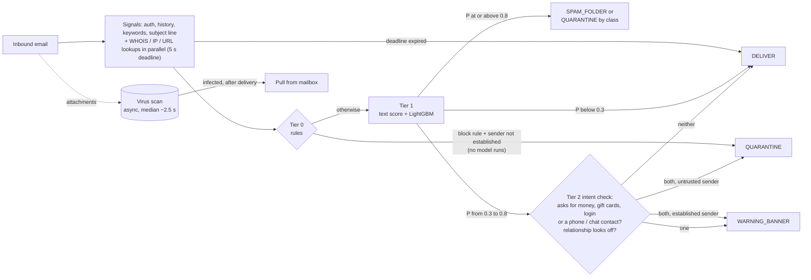

# Spam Filter- bec-guard

bec-guard is a spam, phishing and business email compromise (BEC) filter for a multi-tenant B2B email
platform. It decides what to do with every inbound email within a 5 second window and a budget of
$0.30 per mailbox per month. I built it as a cascade: cheap rules first, then a gradient-boosted model,
then a second look at the roughly 1% of mail the model is unsure about. Everything runs locally on
synthetic data. Across five data seeds, the full cascade detects 94.4 ± 3.0% of BEC emails (91.8 ±
4.8% blocked outright) and flags 7.2 ± 2.4 of roughly 1,550 legit test emails per run, with a p99
latency of 42.8 ± 4.5 ms. The estimated variable cost as implemented is $0.115 per mailbox per month.

## The problem

We run an email platform for businesses. Our customers receive spam, phishing, and impersonation
emails, where someone pretends to be their boss or a vendor, usually to get money moved. For every
inbound email we pick an action and give the admin a reason they can read.

Gmail and Microsoft 365 hand us each message and wait at most 5 seconds. If we have not answered, the
mail is delivered as not spam. The budget is $0.30 per
mailbox per month. A customer has 30 mailboxes, each receiving 5 emails a day. There is a virus-scan
API for attachments, and it is slow (the mock here takes about 2.5 seconds at the median). Customers
range from manufacturing to pharma to legal, so one rule set tuned for one will not fit the others.

## What makes it hard

Spam and most phishing give themselves away: bulk sending, fresh domains, bad links, blocklisted IPs.
Impersonation does not. A fake CEO writing from Gmail passes SPF and DKIM, because Gmail really sent
it, and the wording is the same plain business language real finance teams use ("can you push this
wire through today?"). Content alone is not enough. What matters is who is asking for what, compared
with how this sender normally behaves toward this company.

## How I approached it

The budget sets the architecture. $0.30 over about 150 emails a month (30 days at 5 a day) leaves
roughly $0.002 per email for compute, lookups and attachment scanning together. That rules out a hosted
LLM on every email, so I built a cascade in which each stage only sees what the previous one could not
settle.

The whole decision runs under a hard 5 second timeout, with WHOIS, IP and URL reputation lookups in
parallel. If time runs out, the email is delivered (fail open, as the provider would do). Attachments
go to the virus scanner on arrival; the cascade never waits for it, and if the scanner later finds
malware the email is pulled from the mailbox.

Tier 0 is seven rules, such as lookalike domain, authentication failure and reply-to mismatch. Each
adds a reason code. Two of them (lookalike domain, and a young domain sending in bulk) are precise
enough to quarantine on their own, and only for senders who are not established. They decide before any
model runs.

Tier 1 is a 5-class LightGBM model (legit, spam, phishing, BEC, malware). It uses a TF-IDF and logistic
regression text score plus 30 other features: authentication, domain age, IP reputation, link and
attachment signals, keyword counts, relationship history and the subject line. Each feature only sees
mail that arrived earlier. Below 0.3 P(malicious) the email is delivered. At 0.8 or above it goes to
the spam folder or quarantine, depending on the predicted class.

Tier 2 handles scores from 0.3 to 0.8. It checks whether the email asks for money, gift cards, a login
or contact by phone or chat app, and whether the relationship looks off (an untrusted sender, a sharp
change in topic, a reply-to or display-name mismatch). Both means quarantine, one means a warning
banner, neither means delivery. A TF-IDF intent classifier does the first check, and a keyword layer
for currency amounts, phone numbers, WhatsApp and Telegram overrides it when it fires.

Trust has one definition, used by every tier. A sender is established if this mailbox has written to
them, or if at least 3 of their earlier emails were delivered without a banner and passed DMARC.
Quarantined, spam-foldered or bannered mail never earns trust, and a message failing DMARC is never
established. Tier 0 only blocks senders who are not established, and Tier 2 banners established
senders rather than quarantining them, so a real vendor's payment request still reaches the inbox.

Every email ends in one of four actions:

- DELIVER: normal delivery.
- WARNING_BANNER: delivered with a warning shown to the user.
- SPAM_FOLDER: moved to spam (used for spam).
- QUARANTINE: held back from the user (phishing, BEC and malware).

In the seed 42 test run, Tier 0 decided 5.8% of mail, Tier 1 93.0% and Tier 2 1.2%. The design
choices and the evidence behind them are in [DESIGN.md](DESIGN.md).

## Data

I had no real customer mail, so I generated it: 10 tenants (one per industry) with 30 mailboxes each,
over 60 days. That is 10,000 emails, 78% legit, 8% spam, 6% phishing, 4% BEC and 4% malware, with 2% of
labels flipped to mimic wrong user reports. A sent-mail log lets trust come from what a mailbox
actually sent rather than from a quoted thread an attacker could forge. The hard cases matter most:
hard negatives are legit mail that looks risky (a real CFO asking for an urgent wire), and hard
positives are attacks designed to look normal (hijacked vendor accounts, credential pages on real
SharePoint, ordinary business wording).

The emails come from templates with a few phrasings each, so the model sees far less variety than real
mail, and real-world precision and recall would be lower. The volume is also low, about 0.56 emails per
mailbox per day. As a small check on generalization I wrote 10 emails by hand, mostly in styles the
generator does not use (sextortion, a callback scam, BEC in Spanish). They are only evaluated, never
used for tuning.

## Results

Each run tests on its last 12 days (about 1,940 emails, 380 malicious, 70 BEC). Numbers are mean ±
standard deviation over 5 seeds; each seed regenerates the data and retrains every model. "Detected"
means any action other than DELIVER. Legit flagged is a count per run, out of about 1,550 legit emails.
Models train on the noisy labels; metrics use the true labels.

| Approach | PR-AUC | Precision | Recall | BEC recall, blocked | BEC recall, blocked or bannered | Hard-positive recall | Legit flagged |
|---|---|---|---|---|---|---|---|
| Rules only (Tier 0 block) | 0.582 ± 0.021 | 99.4 ± 1.0% | 28.8 ± 3.0% | 31.8 ± 6.6% | 31.8 ± 6.6% | 0.0 ± 0.0% | 0.8 ± 1.3 |
| Text only (TF-IDF + LR) | 0.895 ± 0.016 | 63.3 ± 2.7% | 85.6 ± 2.4% | 82.3 ± 6.1% | 82.3 ± 6.1% | 65.8 ± 5.6% | 190.8 ± 23.3 |
| Metadata only (no text or subject features) | 0.984 ± 0.006 | 95.8 ± 1.5% | 92.9 ± 1.1% | 85.3 ± 3.4% | 85.3 ± 3.4% | 39.0 ± 16.7% | 15.8 ± 5.8 |
| Full model (LightGBM, no subject features) | 0.994 ± 0.004 | 99.1 ± 0.6% | 97.2 ± 1.1% | 92.6 ± 3.6% | 92.6 ± 3.6% | 59.8 ± 16.0% | 3.2 ± 2.2 |
| Full model + subject features | 0.994 ± 0.004 | 99.1 ± 0.6% | 97.1 ± 1.4% | 92.4 ± 4.4% | 92.4 ± 4.4% | 59.2 ± 15.7% | 3.2 ± 2.2 |
| Cascade without intent check (gray zone gets a banner) | n/a | 98.1 ± 0.6% | 97.7 ± 0.9% | 88.4 ± 4.5% | 94.4 ± 3.0% | 63.7 ± 11.5% | 7.2 ± 2.4 |
| Full cascade | n/a | 98.1 ± 0.6% | 97.7 ± 0.9% | 91.8 ± 4.8% | 94.4 ± 3.0% | 63.7 ± 11.5% | 7.2 ± 2.4 |

For the score rows, blocked and blocked or bannered are the same (a score of 0.5 or more). The cascade
rows have no single score, so PR-AUC is n/a.

Text alone is not enough: it flags 190.8 legit emails per run (12% of legit mail), because real
invoices, payment chasers and IT notices use the same words. Metadata alone catches 85.3% of BEC.
Together they work. The full model keeps BEC recall above 92% while flagging 3.2 legit emails per run.

The cascade adds 2.0 points of BEC recall (blocked or bannered) and 4.5 points of hard-positive recall
over the model, for 4.0 more legit emails flagged per run. The intent check does less than I expected.
Bannering every gray-zone email detects exactly as much. What the intent check changes is how many
attacks get blocked instead of bannered (BEC blocked rises from 88.4% to 91.8%), without flagging more
legit mail. The subject-line features have no measurable effect.

The error bars are wide because each run has only about 70 BEC emails; single runs put BEC recall
(blocked or bannered) anywhere from 89% to 97%. On the 10 hand-written emails, the cascade catches 5.0
± 0.7 of the 6 attacks and delivers 3 of the 4 legit emails cleanly in every seed. Per-class results,
hard cases and top features are in [DESIGN.md](DESIGN.md#15-reference-tables) and
[reports/](reports/eval_report.md).

## Cost and latency

Latency is wall time per email, with the mock lookups really sleeping their simulated latency. The p99
is 42.8 ± 4.5 ms across seeds, against a 2 second target and the 5 second deadline, and no email hit
the deadline. In seed 42 the p50 is 14.6 ms, the p95 30.5 ms, and CPU time about 4.6 ms per email.

The cost is an estimated variable cost under stated deployment assumptions, not a measurement. As
implemented, every reputation lookup is a paid call and every attachment goes through the single
scanner, priced as a sandbox scan. That comes to $0.115 per mailbox per month at the
specified 5 emails a day, 38% of the budget.

Proposed, not implemented: a lookup cache, an attachment hash cache, a cheap antivirus scan on every
file, and the sandbox only for risky file types on mail that was not already quarantined. With those
the estimate is $0.008 (3%). For a heavy inbox of 120 emails a day (Radicati reports 122 sent
and received per business user per day, [2015 report](https://www.radicati.com/wp/wp-content/uploads/2015/02/Email-Statistics-Report-2015-2019-Executive-Summary.pdf)),
the implemented design would cost $2.77, more than 9 times the budget, and the proposed
savings bring it to $0.20 (67%). Both volumes reuse the per-email rates observed in the
replay. Prices and sources are in [DESIGN.md](DESIGN.md#estimated-variable-cost).

## What I found and fixed along the way

The first model scored a perfect 1.000 PR-AUC. That was a warning sign: each class had its own template
wording, so the label leaked through the text. I rewrote the generator so classes share wording, legit
mail sounds risky, and many attacks use plain business language.

Reading the text model's top terms, rather than its metrics, showed that it had learned signatures.
The strongest attack terms were "Ltd" and "Inc", and the strongest legit term was "IT Service Desk". I
now mask URLs, sender display names, recipient names and reply prefixes before the text model sees the
email.

An outside review found holes in trust. One quarantined email could make a stranger "established",
and each tier had its own definition: Tier 0 used the raw count of received mail, Tier 2 accepted one
clean delivery, and DMARC-failing deliveries still counted. One of my hand-written emails exposed
another hole, a DMARC-failing spoof of a colleague inheriting that colleague's trust. There is now one
trust function, with a regression test for each case. The review also found the deadline was only
checked after the model returned. The whole decision now runs under a hard timeout.

## Limitations and what I would do next

Because the data is synthetic, the absolute numbers are optimistic, and the 10 hand-written emails are
a thin real-world check (several overlap generator scenarios).

The main miss is BEC from a hijacked real vendor account (6 of 7 delivered in seed 42). It passes
authentication and sits in a real thread, and because the vendor is established, Tier 2 can at most
banner it. That is a deliberate trade-off, so a real vendor's payment request is never quarantined by Tier 2. Next I would flag any email that
changes bank details, with out-of-band verification, and track each sender's usual writing style and
sending IPs.

Sextortion "from" the recipient's own address with DMARC failing is still delivered in 4 of 5 seeds,
which a rule for that exact case would close. A first-time customer on Gmail asking for a refund is
quarantined in every seed; per-tenant inbox roles would help. Password-protected zips from known
contacts rest on weak signals. On the validation window no gray-zone bound meets my 1% budget for
flagged legit mail, so the most conservative one (0.3) is used, and there is no feedback loop from
user reports.

Beyond these, I would implement the proposed cost savings, try a small local sentence-embedding model
for the text, and consider an LLM for the gray zone only (about 1% of mail); in seed 42 the base case
leaves about $0.10 of budget per gray-zone email.

## How to run

You need Python 3.11 and uv. On macOS, install the OpenMP runtime once with `brew install libomp`;
without it, importing LightGBM fails with `Library not loaded: @rpath/libomp.dylib`.

- `make setup`: create the virtual environment and install dependencies.
- `make data train eval`: generate the data, train the models and write reports/ (about 1 minute).
- `make demo`: open the Streamlit demo on http://localhost:8501.

The demo lets you pick from eight example emails or paste your own, and shows the action, tier, reason
codes and a per-email explanation. `make test` runs the tests, `make validate` reruns model selection
([reports/validation.md](reports/validation.md)), and `make multiseed` reruns everything over 5 seeds
([reports/multiseed.md](reports/multiseed.md)).
