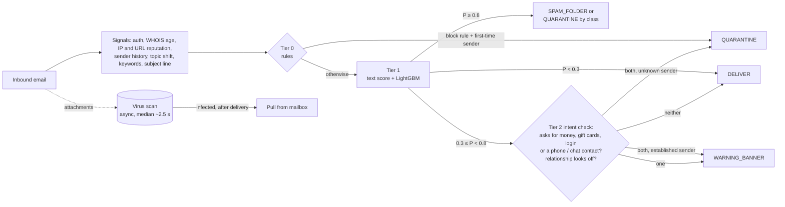

# bec-guard

A tiered spam / phishing / BEC (business email compromise) filter for a multi-tenant B2B email
platform. Cheap rules and a gradient-boosted model handle almost all mail in ~10 ms; only gray-zone
emails get a second look; a slow attachment scan runs in the background. Everything runs locally,
no API keys, on reproducible synthetic data.

**Cost: $0.008 per mailbox per month (~3% of the $0.30 budget)** at the specified 5 inbound emails
per mailbox per day; still within budget ($0.20, ~68%) in a 120 emails/day stress test.

## Key result

Mean ± standard deviation over **5 seeds**: each seed regenerates the synthetic data and retrains every
model, then evaluates on its own held-out last 12 days (~1,930 emails, ~380 malicious, ~70 BEC; true
labels). "Detected" means any action other than DELIVER; models were trained on labels with 2% noise.
Legit flagged is a count per run (~1,550 legit test emails each).

| Approach | PR-AUC | Precision | Recall | BEC recall | Hard-positive recall | Legit flagged |
|---|---|---|---|---|---|---|
| Rules only (Tier 0 block) | 0.582 ± 0.021 | 99.1 ± 2.1% | 11.7 ± 1.9% | 29.2 ± 6.2% | 0.0 ± 0.0% | 0.4 ± 0.9 |
| Text only (TF-IDF + LR) | 0.895 ± 0.016 | 63.3 ± 2.7% | 85.6 ± 2.4% | 82.3 ± 6.1% | 65.8 ± 5.6% | 190.8 ± 23.3 |
| Metadata only (no text or subject features) | 0.986 ± 0.004 | 95.6 ± 1.6% | 92.2 ± 1.6% | 85.5 ± 3.6% | 36.2 ± 20.0% | 16.2 ± 5.9 |
| Full model (LightGBM, no subject features) | 0.995 ± 0.001 | 99.2 ± 0.5% | 96.5 ± 1.4% | 90.9 ± 3.8% | 53.1 ± 14.7% | 3.0 ± 2.0 |
| Full model + subject features | **0.996 ± 0.001** | 99.5 ± 0.3% | 96.8 ± 1.3% | 92.4 ± 4.4% | 53.1 ± 12.1% | 1.8 ± 1.1 |
| **Full cascade** (rules → model → intent check) | – | 97.9 ± 1.2% | 97.8 ± 1.0% | **94.7 ± 4.0%** | **66.8 ± 10.4%** | 8.2 ± 4.8 |

**Out-of-distribution check** (10 hand-written emails in styles the generator never uses, never used for
tuning): **5.0 ± 0.7 of 6 attacks caught, 3 of 4 legit delivered cleanly** in every seed. See
[Out-of-distribution check](#out-of-distribution-check).

Per-seed values: [reports/multiseed.md](reports/multiseed.md) (`make multiseed`, ~1.5 minutes).

- **Text alone is not enough.** It finds most attacks only by also flagging ~191 legit emails per run
  (12% of legit mail), because legit invoices, payment chasers and IT notices use the same words.
- **Relationship + infrastructure features carry BEC.** Who is writing (first-time sender, prior
  exchanges, lookalike or freemail domain, display-name and reply-to tricks) is what separates a real
  CFO's urgent wire request from a fake one. Combining them with the text score gives the best of both.
- **The cascade adds on top of the model:** +2.3 points BEC recall and +13.7 points hard-positive
  recall, paid for with ~6 more warning banners on legit mail per run (~0.5% of legit mail; no legit
  quarantines from Tier 2). The intent check never quarantines an established correspondent; it
  banners them instead.
- **Subject-line features add little** (PR-AUC 0.995 → 0.996; ~1 fewer legit email flagged per run).
  See [Subject-line features](#subject-line-features) for why.
- **Hijacked real accounts remain hard.** Compromised-vendor BEC is the main miss; see
  [Limitations](#limitations).
- **Why five seeds:** each run has only ~70 BEC and ~25 hard-positive test emails, so one email moves
  BEC recall by ~1.4 points and hard-positive recall by ~5. Single runs moved BEC recall between 89%
  and 99%; the standard deviations above are the honest error bars.

The detailed sections below (per-class results, hard cases, SHAP, latency, cost table, demo) come from
a **single run, seed 42**; the full report is [reports/eval_report.md](reports/eval_report.md).

## Quickstart

```bash
make setup               # Python 3.11 venv via uv (macOS: run `brew install libomp` once first)
make data train eval     # ~10k synthetic emails -> models/ -> reports/   (~30 seconds)
make demo                # Streamlit app on http://localhost:8501
```

`make test` runs the test suite; `make multiseed` reruns everything over 5 seeds. **macOS:** LightGBM
needs the OpenMP runtime; without `brew install libomp`, importing it fails with
`Library not loaded: @rpath/libomp.dylib`.

## The problem and the constraints

A B2B email provider must classify every inbound email into **DELIVER**, **WARNING_BANNER**,
**SPAM_FOLDER** or **QUARANTINE**, with reason codes the customer's admin can read.

- **Budget: $0.30 per mailbox per month.** At the specified 5 inbound emails per mailbox per day
  (30 mailboxes per customer) that is 150 emails, so **$0.002 per email** for compute, reputation
  lookups and attachment scanning together. The design must also survive a heavy inbox: at 120/day
  the budget shrinks to $0.00008 per email, where a hosted LLM call on every email is out of reach.
- **Latency: the provider gives up after 5 s** and delivers anyway (fail open). Target p99 < 2 s.
- **BEC is the expensive failure.** It has no malicious link or file to detect; the signal is
  *who* is asking *what*, compared with how this sender normally behaves.
- **Multi-tenant.** Every tenant has its own executives, vendors and correspondents, so "normal"
  must be learned per tenant from point-in-time history.

## Architecture



| Tier | What it does | Share of test mail (seed 42) |
|---|---|---|
| 0: rules | 7 reason-coded rules. Two can quarantine alone (lookalike domain, young domain sending in bulk), and only for first-time senders. None looks at the subject. | 2.7% |
| 1: model | TF-IDF text score + 30 other features in a LightGBM classifier (5 classes). | 95.6% |
| 2: intent check | Gray-zone scores only: what the email asks for (classifier + keyword layer) plus whether the relationship looks off. Never quarantines an established correspondent. | 1.7% |
| async | Attachment scan; never delays delivery, pulls infected mail afterwards. | 0.26 attachments per email |

## How it works

**Synthetic data** (`src/data/`). 10 tenants (one per industry) × 30 mailboxes, 60 days, 10,000 emails:
78% legit, 8% spam, 6% phishing, 4% BEC, 4% malware. Attacks arrive as campaigns (bulk spam across
tenants, targeted BEC). It includes hard negatives (real CFO urgent wires, vendor payment chasers, IT
password notices, staff writing from personal Gmail, a third-party tool failing DMARC, recruiters
talking about fees with a phone number in the signature) and hard positives (hijacked vendor and
partner accounts, credential pages on real SharePoint, password-protected zips). Phishing includes
advance-fee and fake-job scams (a too-good offer, an upfront fee in some currency, "message us on
WhatsApp") with varied wording. 2% label noise, and threat intel for the mocked WHOIS / IP / URL / AV services. A **sent-mail
log** records the tenant's real replies, so "have these two people actually corresponded?" can be
answered from history. Fully seeded.

**Rules** (`src/rules/engine.py`): auth failure, internal-domain spoof, employee display name from
outside, lookalike domain (rapidfuzz vs the tenant's domain, its vendors and major brands), young
domain + high volume, blocklisted IP, reply-to mismatch. Each returns a reason code. Rules whose
precision on the training period was not near-perfect only add reasons; they never decide alone.

**Point-in-time features** (`src/features/extract.py`). 31 features computed by walking inbound mail
and the sent-mail log in time order: each email only sees history from earlier messages (sender's
prior messages to this tenant, prior exchanges with this mailbox in either direction, domain volume
in the last 24 h, topic shift vs the sender's past mail). The quoted thread inside an email is never
trusted, because attackers forge it. A test checks that adding future emails never changes past
features. The split is by time (last 12 days are test); the first 7 days only build history.

**Missing values are neutral.** Some features have nothing to measure: topic shift for a sender with
no earlier mail, link age for an email without links, any lookup that timed out. Left as NaN, LightGBM
learned that "missing" itself means attack (a missing topic shift pushed +0.175 toward attack, because
new senders are mostly attackers in training). The model now sees the training median instead
(+0.004 after the change), and "new sender" is carried only by the explicit `first_time_sender`
feature. Rules still see the raw value, so a timeout never fires a rule.

### Subject-line features

Six features, used by the model only (no rule acts on the subject):

| Feature | What it measures |
|---|---|
| `fake_reply` | Subject starts with RE:/FW:/Fwd: but this mailbox and sender have never exchanged mail (history store, not the quoted thread) |
| `subject_body_sim` | TF-IDF cosine similarity between subject and body |
| `subject_kw` | Urgency / money words in the subject (separate from the body keyword counts) |
| `subject_caps_ratio`, `subject_exclaims`, `subject_emojis` | Style: share of capital letters, "!" count, emoji count |

The generator gives real threads a reply prefix (backed by the sent-mail log), makes 30–40% of
phishing and BEC campaigns fake a reply (half with a forged quoted thread), has colleagues forward
vendor mail, and puts emojis and capitals in some spam and in a few legit newsletters and promos.

Why they add little here: `subject_body_sim` ranks 5th by SHAP and `subject_caps_ratio` 11th, but
`fake_reply` adds almost nothing because every fake reply in this data comes from a brand-new attacker
address, which `first_time_sender` already flags; it would matter for a hijacked account faking a reply.
The style features mainly fire on spam, which is already caught 100%.

### The text approach

- **Tier 1: TF-IDF + logistic regression → `text_score`.** Unigrams and bigrams (never crossing a
  sentence boundary) over subject + body, with URLs, reply prefixes, the sender's display name and the
  recipient's name removed so the model reads *what is said*, not *who signed it*. Its P(malicious) is
  one feature of LightGBM. On training rows the score is **out-of-fold** (5-fold), so LightGBM never
  learns from a score that has already seen that row's label.
- **Tier 2: TF-IDF intent classifier + keyword layer + topic-shift cosine.** A one-vs-rest logistic
  regression predicts four request intents (payment, gift card, credential, urgency), trained on weak
  labels from simple patterns. Next to it, a **deterministic keyword layer** catches any money request
  (a currency amount such as "$5000", "5000 dollar", "Rs 15,000", "USD 250", or words like pay, fee,
  deposit, transfer) and any **off-channel contact** (a phone number, WhatsApp, Telegram). If it fires,
  the intent counts as present whatever the classifier says: a bag-of-words model scored "pay 5000
  dollar as resignation fee" at 0.02 for payment because it had never seen that phrasing. Topic shift is
  1 − cosine similarity between this email's TF-IDF vector and the centroid of the sender's earlier
  emails to this tenant.
- **Why this and not embeddings or an LLM:** it is fast (~1 ms per email on CPU), free (no GPU, no
  API calls, nothing leaves the tenant boundary) and explainable (every weight maps to a word or
  phrase you can read, below; every keyword hit is a reason code).
- **Limitation:** it matches words, not meaning. A paraphrase it has not seen ("handle this discreetly
  for me") or an attacker copying a real vendor's wording passes as normal; that is why the metadata
  and relationship features exist, and why embeddings are listed under future work. The keyword layer
  is deliberately broad, so it also fires on legit invoices and signatures with phone numbers; it only
  acts in the gray zone and only quarantines when the relationship also looks off.

### What the text model learned

Top 15 TF-IDF terms by logistic-regression weight (seed 42, from `make eval`):

| # | Toward attack | Toward legit |
|---|---|---|
| 1 | purchase | unchanged |
| 2 | your | are unchanged |
| 3 | purchase order | payment details |
| 4 | document | hi |
| 5 | last email | tuesday |
| 6 | book time | payment |
| 7 | book | details are |
| 8 | time here | from |
| 9 | last | on the |
| 10 | on my | available |
| 11 | my last | delivery |
| 12 | here url | on |
| 13 | here | are |
| 14 | account | the |
| 15 | brightcart | capabilities deck |

Sensible: "click here" links ("here url"), spam follow-ups ("my last email", "book time"), malware lures
("purchase order", "document"), credential lures ("account"), and on the legit side "payment details are
unchanged" from genuine vendor mail. "payment" leans legit because real payment chasers far outnumber
fraudulent ones, which is exactly why text alone can't catch BEC. Not sensible, and left visible on
purpose: "brightcart" is one tenant's company name (spam and phishing templates name the company),
"capabilities deck" comes from one hard-negative template, and "tuesday", "hi" and function words
reflect template style. Three earlier versions of this list exposed leaks that were fixed: sender
names and company suffixes ("Ltd", "IT Service Desk"), reply prefixes ("fw", "fwd") once fake replies
were added, and a literal "budget review" topic that only fake replies used.

## Out-of-distribution check

`data/ood/emails.json` holds 10 hand-written emails in styles the generator never produces: a fake
remote job asking for a deposit via Telegram, a lottery win with a WhatsApp claims agent, sextortion
with a Bitcoin wallet, an SMS-style parcel notice, a callback scam ("call this number to cancel"),
BEC written in Spanish, and four unusual but legit emails (an emoji-heavy internal note, a terse
vendor with a phone number, a first-time customer asking for a refund, an HR sign-in reminder). They
were written before any fix was evaluated on them and are never used for tuning. `make eval` writes
[reports/ood.md](reports/ood.md).

| | Attacks caught (of 6) | Legit delivered cleanly (of 4) |
|---|---|---|
| Before the keyword layer and advance-fee data (seed 42) | 2 | 3 |
| Now, seed 42 | 5 | 3 |
| Now, 5 seeds | 5.0 ± 0.7 | 3.0 ± 0.0 |

Seed 42, email by email:

| Email | Truth | Action | Tier | Why |
|---|---|---|---|---|
| Fake remote job, deposit via Telegram | phishing | QUARANTINE | 1 | model confident (0.88) |
| Lottery win, agent on WhatsApp | phishing | QUARANTINE | 2 | asks for money + off-channel contact, new sender |
| Sextortion, Bitcoin wallet, spoofs the recipient's own address | phishing | **DELIVER** | 1 | score 0.28, just under the gray zone; only flag rules fired |
| SMS-style parcel notice with a link | phishing | WARNING_BANNER | 2 | new sender, auth failure |
| Callback scam, phone number only | phishing | QUARANTINE | 1 | model confident (0.98) |
| BEC in Spanish from Gmail with the CEO's name | BEC | QUARANTINE | 2 | display-name mismatch + money request + new freemail sender |
| Emoji-heavy internal note | legit | DELIVER | 1 | |
| Terse known vendor with a phone number | legit | DELIVER | 1 | |
| First-time customer on Gmail asking for a refund | legit | **QUARANTINE** | 2 | money request + new freemail sender: indistinguishable from a scam on these signals |
| HR sign-in reminder with a Workday link | legit | DELIVER | 1 | |

Across seeds the sextortion email is delivered in 4 of 5 runs and the refund request quarantined in all
5. Both are listed under [Limitations](#limitations).

## Results (single run, seed 42)

**Per class** (full cascade, final output after the async scan):

| Class | Precision | Recall | F1 | Support | PR-AUC (LightGBM) |
|---|---|---|---|---|---|
| legit | 99.3% | 99.3% | 99.3% | 1574 | 1.000 |
| spam | 97.5% | 100.0% | 98.7% | 115 | 1.000 |
| phishing | 100.0% | 94.2% | 97.0% | 104 | 0.999 |
| **BEC** | **90.4%** | **89.2%** | **89.8%** | 74 | 0.961 |
| malware | 93.3% | 98.6% | 95.9% | 71 | 0.996 |

Classic BEC patterns (CEO gift cards, wire requests from lookalike and freemail domains, payroll
diversion, direct spoofing, vendor-invoice fraud) were detected 65 of 67 times. Most BEC misses came
from **compromised real vendor accounts**: 6 of 7 delivered, 1 bannered.

**Hard cases.** Hard positives: 50.0% detected (compromised partner accounts 3/5, compromised vendor
1/7, password-protected zips 5/6). Hard negatives: 247 in test, none quarantined, 11 bannered (6 real
vendor payment requests, 5 legit password-protected archives).

**Latency** (synchronous path: measured compute plus simulated parallel lookups):
p50 **10.7 ms**, p95 **23.3 ms**, p99 **29.8 ms** (p99 over 5 seeds: 32.5 ± 3.7 ms), well under the
2 s target and the 5 s deadline. Model compute itself is ~1 ms; the slowest external lookup dominates.

**What drives the model (SHAP, top 10):** text_score, payment_kw, sender_domain_age_days,
risky_attachments, subject_body_sim, lookalike_score, min_url_domain_age_days, topic_shift,
url_bad_verdict, ip_score. Chart: [reports/shap_top_features.png](reports/shap_top_features.png).

### Cost vs the $0.30/mailbox/month budget

**Base case: $0.0084 ± 0.0007 per mailbox per month over 5 seeds (~3% of budget)** at the specified
5 inbound emails per mailbox per day. The stress test at 120/day costs $0.20 ± 0.02 (~68%) and still
fits. Table for seed 42:

| Item | Base (5/day) $/mailbox/month | Share of budget | Stress test (120/day) $/mailbox/month | Share of budget |
|---|---|---|---|---|
| Compute (features, rules, models) | 0.0000 | 0.0% | 0.0003 | 0.1% |
| Reputation / WHOIS lookups | 0.0040 | 1.3% | 0.0950 | 31.7% |
| Static AV scan (every attachment) | 0.0010 | 0.3% | 0.0237 | 7.9% |
| Sandbox (risky file types, not already quarantined) | 0.0040 | 1.3% | 0.0966 | 32.2% |
| **Total** | **0.0090** | **3.0%** | **0.2156** | **71.9%** |

**Headroom for a smarter Tier 2:** the base case leaves $0.29/mailbox/month, and only ~2.6 emails per
mailbox per month reach the gray zone (1.7% in seed 42), so Tier 2 could spend up to **~$0.11 per
gray-zone email** on embeddings or an LLM call and still fit the budget.

Assumptions (all in `configs/default.yaml`; measured values come from the eval run):

| Assumption | Value | Source |
|---|---|---|
| Inbound emails per mailbox per day (base) | 5 | The assignment's specification (30 mailboxes per customer). |
| Inbound emails per mailbox per day (stress test) | 120 | A heavy business inbox. Radicati reports 122 emails *sent and received* per business user per day ([2015 report](https://www.radicati.com/wp/wp-content/uploads/2015/02/Email-Statistics-Report-2015-2019-Executive-Summary.pdf)) and ~78 *received* ([2012 survey](https://www.radicati.com/?p=8785)), so 120 inbound is pessimistic. |
| Compute price | $0.04 per vCPU-hour | AWS c7g.large (2 vCPU, on-demand, us-east-1) lists at $0.0725/hour ≈ $0.036/vCPU-hour per third-party trackers ([DoIT](https://www.doit.com/compute/spot/us-east-1/c7g.large), [Holori](https://calculator.holori.com/aws/ec2/c7g.large/us-east-1)); rounded up. |
| Overhead on measured compute | 3× | Assumption: MIME parsing, queueing and retries are not in the measured ~1 ms. |
| Lookups per email | 2.6 | Measured: IP + sender WHOIS + URL reputation and WHOIS per unique link. |
| Lookup cache hit rate | 90% | Assumption: senders, IPs and link domains repeat heavily within hours. |
| Price per uncached lookup | $0.0001 | Assumption: blend of self-hosted feeds and commercial reputation APIs; prices vary widely. |
| Attachments per email | 0.26 | Measured on the synthetic test set (likely higher than real mail). |
| Attachment hash cache hit rate | 50% | Assumption: the same files (invoices, decks, campaign payloads) reach many mailboxes. |
| Static AV scan | $0.00005 per file | Assumption: self-hosted signature scanner, CPU cost only. |
| Sandbox detonation | $0.002 per file | Assumption: order of magnitude for a commercial sandbox; only archives, macro documents and executables on mail that was not already quarantined (0.027 per email measured). |

The first estimate sent every attachment to the sandbox: $0.04 at the base volume, but **$1.00 in the
stress test**, over budget. Tiering the scan (cheap AV for everything, sandbox only for risky types on
mail that will actually be delivered) is the design change that keeps a heavy inbox within budget. The
biggest remaining lever is the lookup cache.

## Demo

`make demo` opens a Streamlit app. Pick one of eight examples (routine invoice, a real CFO's urgent
wire, a lookalike phish blocked at Tier 0, a CEO gift-card request, a gray-zone email decided by the
intent check, a macro malware invoice, a missed hijacked-vendor email, and a job scam reported by a
tester: "You are hired at tesla, pay 5000 dollar as resignation fee at <phone>") or paste your own. It
shows the action, predicted class, tier, latency, reason codes, intent probabilities (Tier 2) and a
per-email SHAP chart, then waits for the async attachment scan.

## Limitations

- **Synthetic data, optimistic numbers.** Emails come from templates with a few phrasings each, so
  even with shared wording, plain-language attacks and label noise, the model sees far less variety
  than real mail. Expect noticeably lower precision and recall on real traffic; the out-of-distribution
  check (5 of 6 attacks, 3 of 4 legit) is the closest thing here to a real-world estimate, and it is
  only 10 emails. The value of this repo is the design, the point-in-time evaluation and the ablation,
  not the absolute scores.
- **Compromised vendor accounts** (6 of 7 delivered in seed 42). The email comes from the real vendor,
  passes SPF/DKIM/DMARC, sits in a real thread and may copy the vendor's normal invoice wording. Because
  the vendor is an established correspondent, the intent check can at most banner it (a deliberate
  trade: real vendors' payment requests must not be quarantined). Proposed fixes:
  - a **new-bank-details flag**: any email that changes payment details triggers a banner and an
    out-of-band verification workflow, whoever sends it;
  - **sender behaviour anomalies**: writing style (sentence length, greeting, signature, vocabulary)
    and send-time / sending-IP / client changes compared with that sender's history.
- **Password-protected zips from known contacts.** 5 of 6 were bannered in seed 42, but the scanner
  can't open them and the sender is trusted, so detection rests on weak signals (an earlier data draw
  missed 5 of 6). Proposed fix: a **banner on password-protected archives from senders who have not
  sent one before**, and blocking archives whose password is in the same email.
- **Self-spoofed extortion (OOD).** Sextortion "from" the recipient's own address with DMARC failing is
  delivered in 4 of 5 seeds: it only trips flag rules, and the model has never seen extortion wording.
  Proposed fix: quarantine mail whose From is the recipient's own address and fails DMARC (a precise
  rule that does not exist yet).
- **First-time customers asking for money (OOD).** A refund request from a new Gmail address is
  quarantined in every seed: "new freemail sender + money request" is exactly the scam pattern.
  Proposed fix: per-tenant inbox roles (a support or billing mailbox expects strangers asking about
  money, so Tier 2 should banner there, not quarantine).
- **Why Tier 2 adds modestly here.** Rules and LightGBM settle ~98–99% of mail on their own, so only
  ~1% reaches the gray zone (+2.3 points BEC recall and +13.7 points hard-positive recall over LightGBM
  alone, for ~6 more legit banners per run). Topic shift is a weak signal on this data because legit
  senders already write about many topics (median shift 0.78 for legit vs 0.83 for BEC). With
  established correspondents only bannered, the intent check quarantines no legit mail on the
  validation window at the chosen bound, but widening still costs banners: lowering it from 0.3 to 0.1
  lifts hard-positive recall from 86% to 95% and bannered legit mail from 4 to 27 emails (0.4% → 3.0%
  of legit mail). With a budget of at most 1% of legit mail bannered, 0.3 stays.
- **The async virus scan caught nothing extra** in this test set: everything it can detect was already
  quarantined by the sync path, and what it can't open (encrypted archives) it can't help with.
- **No feedback loop.** User "report phishing" clicks, admin overrides and per-tenant thresholds are
  not modelled.

## Future work

- **Sentence embeddings** (a small local model such as MiniLM on CPU) for the text score and topic
  shift, to catch paraphrases that TF-IDF misses.
- **An LLM tier for the gray zone only** (~1% of mail), asking "is this a request to move money or
  credentials, and is it unusual for this sender?" Only affordable because the cascade filters 99%
  first, and only with a provider and data-handling terms suitable for customer mail.
- Per-tenant calibration and thresholds, behavioural sender profiles (send times, clients, IPs),
  and an analyst feedback loop.

## Repository layout

```
configs/default.yaml     all parameters, seeds, cost assumptions
src/data/                synthetic tenants, email stream and sent-mail log (generate.py, templates.py)
src/services/            mocked WHOIS / IP / URL reputation / virus scan with latency + timeouts
src/rules/engine.py      Tier 0 rules and reason codes
src/features/extract.py  point-in-time features, incl. subject-line features
src/models/              text model + LightGBM training
src/pipeline/            cascade and Tier 2 intent model
src/eval/report.py       evaluation -> reports/
src/eval/multiseed.py    whole pipeline over 5 seeds -> reports/multiseed.md
src/eval/ood.py          hand-written out-of-distribution check -> reports/ood.md
data/ood/emails.json     the 10 out-of-distribution emails
demo/streamlit_app.py    demo app
tests/                   services, data, features, cascade
```

Design trade-offs are in [DESIGN.md](DESIGN.md).
