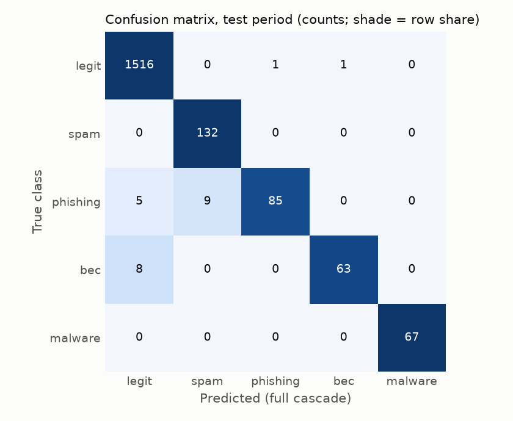
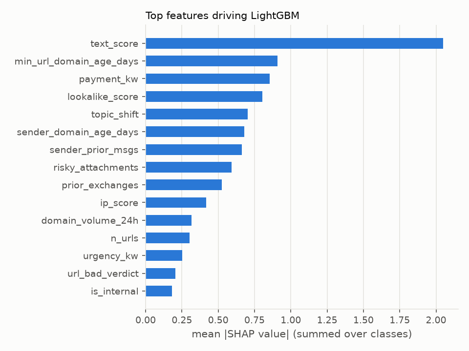

# Evaluation report

Test period: last 12 days (1963 emails, 388 malicious). Metrics use true
labels; models were trained on labels with 2% noise. Generated by `make eval`.

## Ablation

Binary task: malicious vs legit. Thresholds: 0.5 for scores; for the cascade a detection is an action
other than DELIVER (or only SPAM_FOLDER / QUARANTINE for "blocked"). PR-AUC needs a score, so it is
blank for the cascade rows. Hard negatives in test: 247.

|  | precision | recall | f1 | pr_auc | bec_recall | hard_pos_recall | hard_neg_fp | legit_fp |
|---|---|---|---|---|---|---|---|---|
| Rules only (Tier 0 block) | 100.0% | 17.0% | 29.1% | 0.585 | 59.4% | 0.0% | 0 | 0 |
| Text only (TF-IDF + LR) | 53.7% | 87.4% | 66.5% | 0.860 | 92.8% | 81.8% | 85 | 292 |
| Metadata only (no text features) | 96.5% | 93.0% | 94.8% | 0.985 | 84.1% | 36.4% | 13 | 13 |
| Full model (LightGBM) | 100.0% | 95.9% | 97.9% | 0.993 | 97.1% | 51.5% | 0 | 0 |
| Full cascade (blocked) | 99.7% | 94.1% | 96.8% | – | 95.7% | 33.3% | 1 | 1 |
| Full cascade (blocked or banner) | 99.2% | 95.9% | 97.5% | – | 97.1% | 54.5% | 3 | 3 |
| Full cascade + async virus scan | 99.2% | 95.9% | 97.5% | – | 97.1% | 54.5% | 3 | 3 |

## Per-class results (full cascade + async scan)

|  | precision | recall | f1 | support | pr_auc (LightGBM) |
|---|---|---|---|---|---|
| legit | 99.0% | 99.8% | 99.4% | 1575 | 0.999 |
| spam | 99.3% | 100.0% | 99.6% | 137 | 1.000 |
| phishing | 100.0% | 91.9% | 95.8% | 111 | 0.995 |
| bec | 95.7% | 95.7% | 95.7% | 69 | 0.988 |
| malware | 100.0% | 93.0% | 96.4% | 71 | 0.996 |

**BEC** is the class that matters most and is hardest: no links, no attachments to scan, often sent from a
real or freemail account. BEC actions by scenario:

|  | DELIVER | QUARANTINE | WARNING_BANNER |
|---|---|---|---|
| bec:direct_spoof | 0 | 3 | 0 |
| bec:gift_cards | 0 | 13 | 0 |
| bec:payroll | 0 | 4 | 0 |
| bec:vendor_invoice | 0 | 29 | 0 |
| bec:wire_freemail | 0 | 1 | 0 |
| bec:wire_lookalike | 0 | 14 | 0 |
| hard_pos:compromised_vendor | 2 | 2 | 1 |

### Actions per true class

|  | DELIVER | WARNING_BANNER | SPAM_FOLDER | QUARANTINE |
|---|---|---|---|---|
| legit | 1572 | 2 | 0 | 1 |
| spam | 0 | 0 | 137 | 0 |
| phishing | 9 | 6 | 0 | 96 |
| bec | 2 | 1 | 0 | 66 |
| malware | 5 | 0 | 0 | 66 |

## Hard cases

Hard positives are attacks from real, trusted accounts or with copied legit wording; hard negatives
are legit mail that looks risky. Recall on hard positives (any action but DELIVER):
**54.5%**. Hard negatives
blocked: **1**,
bannered: **2**.

|  | n | blocked | banner | delivered |
|---|---|---|---|---|
| hard_neg:encrypted_zip | 16 | 0 | 0 | 16 |
| hard_neg:exec_gift_cards | 17 | 0 | 0 | 17 |
| hard_neg:exec_urgent_payment | 39 | 0 | 0 | 39 |
| hard_neg:internal_tool | 21 | 0 | 0 | 21 |
| hard_neg:it_password | 35 | 0 | 0 | 35 |
| hard_neg:new_vendor | 17 | 0 | 0 | 17 |
| hard_neg:personal_account | 18 | 0 | 0 | 18 |
| hard_neg:promo | 12 | 0 | 0 | 12 |
| hard_neg:rebrand | 20 | 0 | 0 | 20 |
| hard_neg:vendor_bank_change | 15 | 0 | 0 | 15 |
| hard_neg:vendor_payment_request | 37 | 1 | 2 | 34 |
| hard_pos:compromised_account | 22 | 8 | 6 | 8 |
| hard_pos:compromised_vendor | 5 | 2 | 1 | 2 |
| hard_pos:password_zip | 6 | 1 | 0 | 5 |

## What drives the model (SHAP)

|  | mean |SHAP| |
|---|---|
| text_score | 1.707 |
| payment_kw | 0.951 |
| min_url_domain_age_days | 0.856 |
| sender_domain_age_days | 0.816 |
| lookalike_score | 0.806 |
| topic_shift | 0.723 |
| sender_prior_msgs | 0.682 |
| risky_attachments | 0.600 |
| prior_exchanges | 0.485 |
| ip_score | 0.356 |
| domain_volume_24h | 0.352 |
| urgency_kw | 0.308 |
| n_urls | 0.262 |
| url_bad_verdict | 0.222 |
| offdomain_urls | 0.210 |

### What the text model learned

Top TF-IDF terms by logistic-regression weight (URLs, sender display names and the recipient's name are
masked before vectorising; bigrams never cross a sentence boundary).

|  | toward attack | toward legit |
|---|---|---|
| 1 | authentication today (+2.20) | unchanged (-2.69) |
| 2 | account (+2.07) | are unchanged (-2.69) |
| 3 | here url (+1.96) | payment details (-2.52) |
| 4 | here (+1.94) | details are (-2.41) |
| 5 | last email (+1.93) | walk (-2.37) |
| 6 | on my (+1.93) | are (-2.30) |
| 7 | last (+1.93) | walk through (-2.29) |
| 8 | book (+1.93) | through it (-2.29) |
| 9 | my last (+1.93) | it on (-2.29) |
| 10 | time here (+1.93) | to walk (-2.29) |
| 11 | book time (+1.93) | the (-2.16) |
| 12 | purchase (+1.92) | from (-2.06) |
| 13 | purchase order (+1.75) | through (-2.02) |
| 14 | 47 (+1.68) | hi (-1.99) |
| 15 | the updated (+1.62) | on (-1.97) |

## Latency

End-to-end synchronous latency per email: measured compute (features, rules, both models, intent
check) plus the simulated external lookups, which fan out in parallel (so the slowest one counts).
Mean compute alone: 1.7 ms. Budget: p99 under 2000 ms; provider
deadline 5000 ms.

|  | p50 | p95 | p99 | max |
|---|---|---|---|---|
| end-to-end ms | 10.4 | 23.2 | 29.4 | 62.7 |

Decided at Tier 0: 3.4%, Tier 1: 95.7%, Tier 2 (gray zone): 1.0%.
The virus scan runs asynchronously; it pulled 0 delivered emails after the fact: everything it detected had already been quarantined by the synchronous path.

## Cost vs the $0.30/mailbox/month budget

**Base case** (5 inbound emails per mailbox per day, as specified):
**$0.0083/mailbox/month (2.8% of budget)**.
**Stress test** (120/day): $0.1992 (66.4%),
still within budget.

**Headroom for a smarter Tier 2:** the base case leaves $0.29/mailbox/month. With
1.0% of mail in the gray zone that is 1.5 emails per mailbox per month, so up to
**$0.20 per gray-zone email** could go to embeddings or an LLM call and still fit the budget.

Other assumptions (configs/default.yaml):
$0.04/vCPU-hour with a 3.0x overhead on measured compute,
90% cache hits on lookups at $0.0001 each, and
50% hash-cache hits on attachments. Every attachment gets a self-hosted static AV
scan ($0.00005); only archives, macro documents and executables / disk images go to the
sandbox ($0.002), and only when the email was not already quarantined. Measured on this run:
2.7 lookups, 0.25 attachments and
0.022 sandbox submissions per email.

|  | base: $/mailbox/month | base: share of budget | stress: $/mailbox/month | stress: share of budget |
|---|---|---|---|---|
| Compute (features, rules, models) | 0.0000 | 0.0% | 0.0002 | 0.1% |
| Reputation / WHOIS lookups | 0.0041 | 1.4% | 0.0975 | 32.5% |
| Static AV scan (every attachment) | 0.0009 | 0.3% | 0.0226 | 7.5% |
| Sandbox (risky types, not quarantined) | 0.0033 | 1.1% | 0.0789 | 26.3% |
| **Total** | 0.0083 | 2.8% | 0.1992 | 66.4% |
